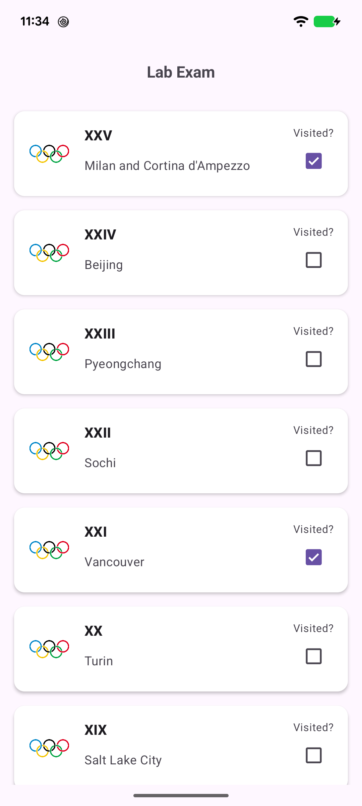
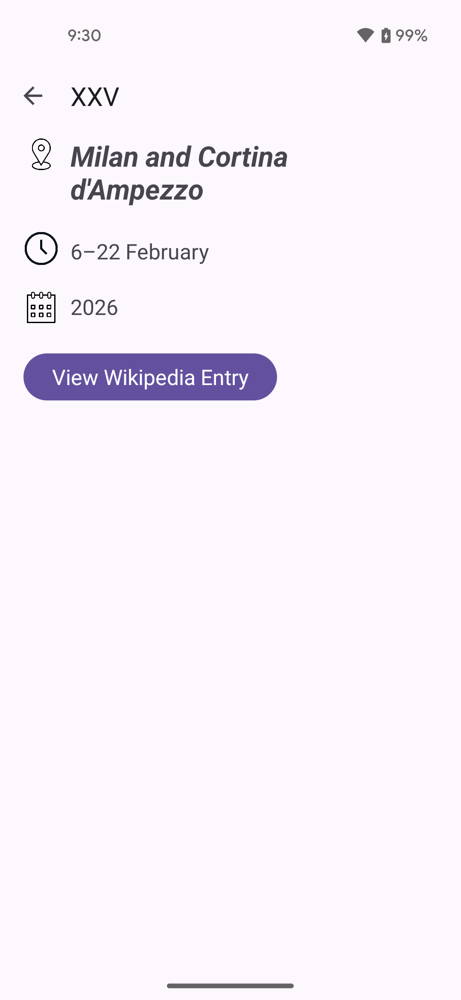

# Lab Exam

This lab exam is a combination of pieces you have seen in the previous labs as well as some items we have covered in class.  It is made up of two sets of TODO items; one for the functionality to read and show the events listing and details and another for working with SharedPreferences storage.

**You must not communicate with others (in person or online) during the exam.**

# Winter Olympics Host Games App

This past year Canadian athetes competed in the latest installment of the [Winter Olympic Games](https://en.wikipedia.org/wiki/Winter_Olympic_Games) which were held in Italy.  We will mark this occasion by building an app that displays information about all of the winter games that have taken place in the past.

This app will consist of two activities. The main activity will include a `RecyclerView` where the items are the Olympiad number and host city name along with checkboxes that the user can check when they have seen an item.

Clicking on the name of a host city will take the user to a detail activity
that shows the extra details about the particular games (Year of the games, dates) along with a button to view the Wikipedia entry for more information on the games themselves. Pressing back from the detail activity takes the user back to the main activity. See examples below.

The instructor has Android devices with a sample solution installed. You can ask to briefly borrow one of these devices to see the intended functionality.

### Main activity:

### Detail activity:

## Skeleton Code

You have been provided with skeleton code. The structure of the app
will be familiar to you from previous labs.

* `helpers/SharedPreferencesHelper.kt` 
  * Instance object used to work with SharedPreferences

* `models/Event.kt` 
  * Data class which represents represents an event
  
* `utis/JsonUtils.kt`
  * Class used to load the details from the JSON assets file
  * The app will make use of the contents included in an included asset file

* `utils/LoadDataTask.kt`
  * Class used to read in the details and updated the view using a separate thread

* `Contants.kt`
  * Contains constant values for intent extra keys

* `DetailActivity.kt`
  * Corresponds to the second screenshot above, displaying information about a specific host city
    * It doesn't do much yet as you will be completing it

* `EventListAdapter.kt` 
  * Corresponds to the RecyclerView class being used to populate the view with event information.
    * When the event row is clicked the `DetailActivity` will be launched via an explicit `Intent`
    * Will also use `SharedPreferences` to store information about which event the user has visited

* `MainActivity.kt`
  * Display a list of events displayed in a `RecyclerView`
  

## Lab Tasks

1. Complete the list of TODOs found in `MainActivity.kt`, `DetailActivity.kt`, `LoadDataTask.kt`, and `EventListAdapter.kt`.

2. Once you have the application running with the first set of changes complete the TODOs related to using `SharedPreferences` which are labeled as `TODO: SharedPreferences`.
  * These tasks can be found in `SharedPreferencesHelper.kt` and `EventListAdapter.kt`.
    * The keys will be a string value for the Olympic event number associated with a host nation and the values will be a boolean.
      * True representing that a user has visited a nation and false representing that a user has not
      * If an id is not found in the `SharedPreferences` its value will be assumed to be false

NOTES:
 * **Only make changes to the files with TODO tasks specified in them; you must not make changes to any other files.**
    * If you think you need to modify any other file, ask the instructor or TA.
 * Please also leave the TODO comments in the code for marking.

## Hints

This lab is open everything.  As a recommendation your first reference point should be to your previous completed labs and the [class examples](https://github.com/hpowell-UNB/cs2063-fall-2026-examples).  

Outside of those projects feel free to make use of Android documentation, StackOverflow, Google, etc.  Here are additional links that might be helpful. 

### Broswer Intents

* <https://developer.android.com/guide/components/intents-common.html#Browser>
* <https://developer.android.com/reference/android/net/Uri.html#parse(java.lang.String)>
* <https://developer.android.com/reference/android/content/Intent.html#resolveActivity(android.content.pm.PackageManager)>

### Checkboxes

* <https://developer.android.com/reference/android/widget/CheckBox.html>
* <https://developer.android.com/reference/android/widget/CompoundButton.html#setChecked(boolean)>

### Shared Preferences

* <https://developer.android.com/reference/android/content/SharedPreferences.html#getBoolean(java.lang.String,%20boolean)>
* <https://developer.android.com/reference/android/content/SharedPreferences.html#edit()>
* <https://developer.android.com/reference/android/content/SharedPreferences.Editor.html#putBoolean(java.lang.String,%20boolean)>

## Deliverables

When you are done, submit `MainActivity.kt` and `DetailActivity.kt`, `LoadDataTask.kt`, `SharedPreferencesHelper.kt`, and `EventListAdapter.kt` to the LabExam Dropbox folder on D2L.

## Final Words

Good luck, and have fun!

If you get stuck ask a question. As this is an exam the instructor and TA can only provide limited answers. However, depending on the nature of the problem they might be able to help.

In any case submit your best effort. Your code will be read when it is marked, so it is possible to do well on this exam even if your code does not run correctly.
